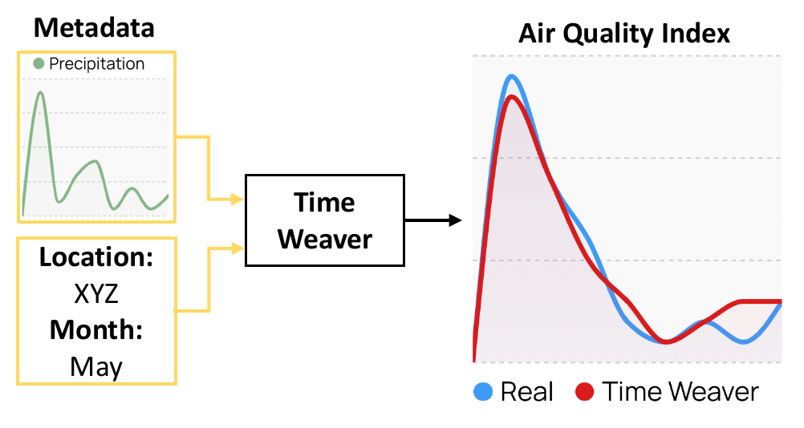
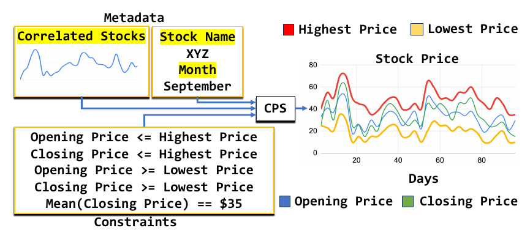

<h1 align="center">Time Weaver &amp; CPS</h1>

<h3 align="center">Conditional and Constrained Time Series Generation with Diffusion Models</h3>

<p align="center">
  <b>Time Weaver</b> (ICML'24 <b>Spotlight</b>) &nbsp;·&nbsp;
  📄 <a href="https://openreview.net/forum?id=WpKDeixmFr">Paper</a> &nbsp;|&nbsp;
  <a href="https://proceedings.mlr.press/v235/narasimhan24a.html">PMLR</a>
  <br>
  <b>Constrained Posterior Sampling</b> (NeurIPS'25) &nbsp;·&nbsp;
  📄 <a href="https://proceedings.neurips.cc/paper_files/paper/2025/file/9b01c4a7d3fc49875dad3c13848bcd9e-Paper-Conference.pdf">Paper</a>
</p>

This repository contains the code for two papers that share one codebase:

- **Time Weaver** (ICML 2024 **Spotlight**) is a diffusion model that generates time series conditioned on
  heterogeneous metadata: categorical, continuous, and time-varying variables
  (for example, a location, a month, and the precipitation forecast). The paper
  also introduces **J-FTSD**, a metric that scores both the realism of generated
  samples and how well they match their metadata.
- **Constrained Posterior Sampling (CPS)** generates time series that satisfy
  hard constraints (for example, OHLC bounds on stock prices or a fixed mean)
  without retraining. After each denoising step, CPS projects the posterior mean
  estimate into the constraint set. It scales to around 100 constraints, and
  runs on top of a trained Time Weaver model.

| Time Weaver: metadata-conditioned generation | CPS: generation under hard constraints |
| :---: | :---: |
|  |  |

## Repository layout

```
configs/                          Hydra configs for training (diffusion, GAN, J-FTSD/CLTSP)
  constrained_generation_configs/ per-dataset configs for generation and evaluation
timeseries_synthesis/             the Python package (models, dataloaders, metrics, constraints)
  scripts/                        entry points for training, generation, and evaluation
evaluation/
  Time-Series-Library/            TSTR imputation (fork of thuml/Time-Series-Library, MIT)
  TimeGAN/                        discriminative score (fork of jsyoon0823/TimeGAN)
docs/EXPERIMENTS.md               how to run each experiment
```

## Installation

The main code uses Python 3.9.12 and Poetry:

```bash
conda create -c conda-forge python=3.9.12 -n timeweaver_cps
conda activate timeweaver_cps
pip install poetry
export PYTHON_KEYRING_BACKEND=keyring.backends.null.Keyring
poetry install
```

`environment.yml` records the exact environment used for the papers. The two
evaluation tools need their own environments (see [Evaluation](#evaluation)).

## Data and checkpoints

Download the preprocessed datasets and the pretrained checkpoints, then unzip
both at the repository root:

- **Datasets** (air quality, stocks, traffic, waveforms):
  [Google Drive](https://drive.google.com/file/d/11Gz-thfqaqn5-O0bsjeYhUz-FOb1nckA/view?usp=sharing)
- **Checkpoints** (diffusion, GAN, CLTSP for J-FTSD, and Loss-DiffTime):
  [Google Drive](https://drive.google.com/file/d/1iFTCmQxFZVQd6SwxbsAGT1XgvNRg9gvG/view?usp=sharing)

```
data/
  air_quality/  stocks/  traffic/  waveforms/  waveforms_truncated/
logs/
  diffusion_model_logs/<dataset>/checkpoints/<dataset>.ckpt
  gan_logs/<dataset>.ckpt
  cltsp_logs/<dataset>.ckpt
  loss_difftime_logs/<dataset>/checkpoints/<dataset>.ckpt
```

`<dataset>` is one of `air_quality`, `air_quality_conditional`, `stocks`,
`traffic`, `traffic_conditional`, or `waveforms`. The `_conditional` variants are
the metadata-conditioned (Time Weaver) models.

## Quick start

Hydra changes the working directory at run time, so pass **absolute** paths.
All commands run from the repository root. The examples below use the
conditional traffic dataset:

```bash
REPO=$PWD
DATA=$REPO/data/traffic
DIFFUSION_CKPT=$REPO/logs/diffusion_model_logs/traffic_conditional/checkpoints/traffic_conditional.ckpt
GAN_CKPT=$REPO/logs/gan_logs/traffic_conditional.ckpt
CLTSP_CKPT=$REPO/logs/cltsp_logs/traffic_conditional.ckpt
```

**1. Generate samples** with the pretrained Time Weaver model. Samples go to
`logs/diffusion_model_logs/traffic_conditional/normal/{train,val,test}/`:

```bash
poetry run python timeseries_synthesis/scripts/generate_constrained_synthetic_dataset.py \
  --config-name=traffic_conditional.yaml \
  synthesizer_wrapper_checkpoint_path=$DIFFUSION_CKPT \
  traffic_dataset.log_dir=$DATA \
  discriminator_params.discriminator_wrapper_checkpoint_path=$GAN_CKPT
```

**2. Generate under hard constraints with CPS** by adding three flags:

```bash
poetry run python timeseries_synthesis/scripts/generate_constrained_synthetic_dataset.py \
  --config-name=traffic_conditional.yaml \
  synthesizer_wrapper_checkpoint_path=$DIFFUSION_CKPT \
  traffic_dataset.log_dir=$DATA \
  discriminator_params.discriminator_wrapper_checkpoint_path=$GAN_CKPT \
  use_projection=True project_during_synthesis=True use_penalty_based_projection=True
```

**3. Score the samples with J-FTSD** (lower is better). Add the same method flags
as in step 2 to score CPS samples instead of unconstrained ones:

```bash
poetry run python timeseries_synthesis/scripts/generate_timeseries_and_condition_embeddings.py \
  --config-name=traffic_conditional_eval.yaml \
  similarity_checker_wrapper_checkpoint_path=$CLTSP_CKPT \
  synthetic_dataset_dir=$REPO/logs/diffusion_model_logs/traffic_conditional/ \
  traffic_dataset.log_dir=$DATA
```

For another dataset, swap the config name (`air_quality_conditional.yaml`,
`stocks.yaml`, ...), the `<dataset>_dataset.log_dir` key, and the checkpoints.

## Training

Each command writes checkpoints and MLflow logs under `BASE_DIR`:

```bash
BASE_DIR=$REPO/runs

# Time Weaver (conditional diffusion). Add csdi_timeseries_denoiser_v4_config.use_metadata=False for unconditional
poetry run python timeseries_synthesis/scripts/train_pl_model.py --config-name=config_timeweaver_diffusion.yaml \
  base_path=$BASE_DIR dataset_name=traffic traffic_dataset.log_dir=$DATA

# J-FTSD feature extractor (CLTSP)
poetry run python timeseries_synthesis/scripts/train_pl_model.py --config-name=config_cltsp_metric.yaml \
  base_path=$BASE_DIR dataset_name=traffic traffic_dataset.log_dir=$DATA
```

To use a trained model, copy its `best_model.ckpt` to the matching `logs/`
location above. Commands for the GAN baseline, the FTSD extractor, and
constraint-aware training (Loss-DiffTime) are in
[docs/EXPERIMENTS.md](docs/EXPERIMENTS.md#training).

## Constrained generation methods

Add these flags to the generation command to run CPS or a baseline:

| Method | Flags |
| --- | --- |
| Unconstrained (Time Weaver) | *(none)* |
| **CPS (ours)** | `use_projection=True project_during_synthesis=True use_penalty_based_projection=True` |
| COP | `use_projection=True project_after_synthesis=True use_real_seed=True` |
| COP-FT | `use_projection=True project_after_synthesis=True` (run unconstrained generation first) |
| Diffusion-TS | `use_guidance=True` |
| Guided-DiffTime | `use_diffts=True` |
| PDM | `use_projection=True project_during_synthesis=True use_strict_projection=True` |
| PRODIGY | `use_projection=True project_during_synthesis=True use_strict_projection=True use_prodigy=True` |

Each method writes its samples to its own folder under
`logs/diffusion_model_logs/<dataset>/`. For example, CPS writes to
`<N>_constraints/projection_during_synthesis_with_penalty_based_projection_using_exp/`.
The OHLC constraint for stocks also needs `STOCKS_DATASET_DIR=$REPO/data/stocks`.

## Evaluation

| Metric | Command |
| --- | --- |
| J-FTSD / FTSD | `timeseries_synthesis/scripts/generate_timeseries_and_condition_embeddings.py` |
| DTW distance | `timeseries_synthesis/scripts/compute_dtw_metric.py` |
| Constraint violation | `timeseries_synthesis/scripts/compute_constraint_violation_rate.py` |
| TSTR (train on synthetic, test on real) | `evaluation/Time-Series-Library/scripts/tstr_imputation_scripts/` |
| Discriminative score | `evaluation/TimeGAN/metrics_computation.py` |

The first three use the same arguments as step 3 above.

**TSTR** trains a TimesNet imputation model on synthetic data and tests it on
real data, over 3 seeds. It needs its own environment,
`evaluation/Time-Series-Library/cps_neurips_tstr.yml`. Set `real_data_dir` and
`synthetic_data_dir` in a script such as
`traffic_conditional_scripts/traffic_conditional_cps.sh`, then run it from
`evaluation/Time-Series-Library/`. Each seed prints its test MSE.

**Discriminative score** needs `evaluation/TimeGAN/cps_neurips_ds.yml`. Set the
paths in `get_real_and_synthetic_paths` in `metrics_computation.py`, then run
`python metrics_computation.py traffic_conditional` from `evaluation/TimeGAN/`.

## More experiments

[docs/EXPERIMENTS.md](docs/EXPERIMENTS.md) has the full set of commands. It covers
varying the number of constraints, models trained with constraints, inference
latency, non-convex constraints, and the choice of penalty coefficients.

## Citation

```bibtex
@InProceedings{pmlr-v235-narasimhan24a,
  title = {Time Weaver: A Conditional Time Series Generation Model},
  author = {Narasimhan, Sai Shankar and Agarwal, Shubhankar and Akcin, Oguzhan and Sanghavi, Sujay and Chinchali, Sandeep},
  booktitle = {Proceedings of the 41st International Conference on Machine Learning},
  year = {2024},
  address = {Vienna, Austria},
  url = 	 {https://proceedings.mlr.press/v235/narasimhan24a.html},
  month = 	 {7},
  doi={10.5555/3692070.3693584}
}

@inproceedings{Narasimhan2025constrained,
    title={Constrained Posterior Sampling: Time Series Generation with Hard Constraints},
    author={Sai Shankar Narasimhan and Shubhankar Agarwal and Litu Rout and Sanjay Shakkottai and Sandeep Chinchali},
    booktitle={The Thirty-Ninth Annual Conference on Neural Information Processing Systems},
    year={2025},
    month = {12},
    address = {San Diego, USA},
    url={https://openreview.net/forum?id=iBLAYaEKdL},
    doi={10.52202/085713-3599}
}
```

## Acknowledgements

TSTR uses a fork of [Time-Series-Library](https://github.com/thuml/Time-Series-Library)
(MIT license), and the discriminative score uses a fork of
[TimeGAN](https://github.com/jsyoon0823/TimeGAN). Each fork keeps its original
license file.
